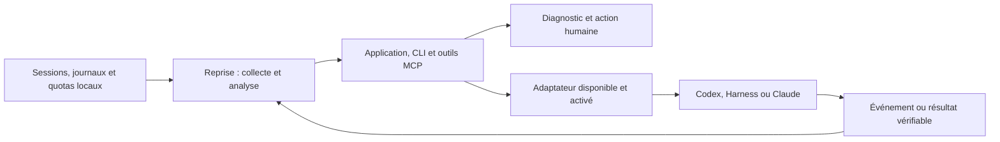
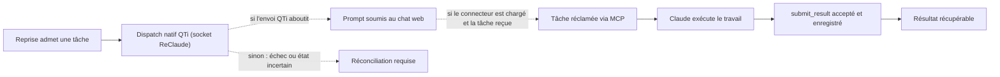

# Reprise & Harness

Reprise est une application macOS de supervision des agents et de continuité des tâches. Elle rassemble des observations locales, des diagnostics après mise à jour, des reprises planifiées et des connecteurs vers plusieurs harness. Chaque action dépend des capacités et des preuves propres à son adaptateur : une configuration ou un accusé de soumission ne prouve ni le chargement du connecteur ni l'achèvement d'un travail.

## Vue d'ensemble



Le schéma résume les chemins possibles. La portée de lecture, le contrôle d'action et le niveau de preuve varient selon le harness ; certains parcours restent expérimentaux ou manuels.

## Fonctions et état

| Domaine | Fonction | État et limites |
| --- | --- | --- |
| Supervision locale | Observe des sessions et journaux pris en charge, reconstruit certains travaux interrompus, affiche les diagnostics et la santé après mise à jour. Recherche et cache d'analyse locaux chiffrés ; explications génératives Foundation Models facultatives, avec les règles déterministes comme référence. | La veille signale les actions à examiner ; elle ne pilote pas les interfaces. Le chiffrement ne couvre pas les journaux, instructions de tâches ni bases des applications sources. |
| Reprises et quotas | Planifie des continuations Codex après certains refus de quota, conserve l'événement et contrôle le résultat natif ; propose une reprise CLI Harness explicite avec profil existant. | La reprise automatique sur quota est limitée à Codex et reste soumise à l'authentification, aux permissions et à la disponibilité du compte. Une fin de tour n'établit pas la réussite métier. Les autres adaptateurs peuvent être en détection seule. |
| Délégation | `reprise_delegate` et les outils associés fournissent des appels et suivis Codex avec reçus durables. Côté Claude, le dispatch natif QTi (socket `quick-entry-reprise.sock` tenu par ReClaude) transmet un tour et MCP réclame une tâche et rend le résultat. | Le dispatch QTi est fire-and-forget : au plus une admission, jamais la réponse. Pour une tâche MCP, seul `submit_result` accepté établit le retour ; un état incertain ne déclenche pas de renvoi automatique. L'existence d'un connecteur ne prouve ni son chargement dans le client ni un échange réel. |
| Projets, mémoire et checkpoints | Un registre prototype associe des UUID de projets à des workspaces existants. Une API locale expérimentale conserve des faits et des checkpoints chiffrés, explicitement liés au projet et au travail. | L'association de projet n'installe pas de connecteur. L'API mémoire n'est pas exposée comme outil au modèle et ne déclenche pas d'inférence. La lecture mémoire exige le pilote activé et une action explicite avec projet et travail sélectionnés. L'orchestration et la délégation Apple automatiques ne sont pas raccordées. |
| Route `foundation-models/system` | `reprise_delegate` propose un appel local explicite à `/usr/bin/fm`, avec contexte borné et reçu récupérable. | Disponible sur macOS 27+ lorsque le modèle est pris en charge par l'appareil. La présence de l'exécutable ne garantit pas la disponibilité du modèle ni une génération. Cette route n'a ni outils, ni suivi conversationnel, ni repli automatique. |
| Pilote conversationnel Apple | Pilote local expérimental pour consulter un projet ou un checkpoint dans une session conversationnelle volatile. | La migration initiale des préférences l'active par défaut, sans démarrer le pilote ni lancer d'inférence. La réouverture automatique d'une session sauvegardée exige que les sélections de projet, travail, checkpoint éventuel et compétence soient inchangées, et que le contexte soit ouvrable. La lecture d'un checkpoint reste une action explicite. La disponibilité du modèle dépend de l'appareil. |
| Intégrations et mises à jour | Les parcours gérés inspectent, planifient, appliquent, vérifient et retirent des composants ; les procédures de build et de mise à jour conservent les états et distinguent les releases. | Vérifier séparément la configuration écrite, le chargement client, la découverte des outils et un échange de bout en bout. La CI produit un artefact de validation ; elle ne publie ni ne déploie l'application. |
| Routage expérimental | Des embeddings Apple locaux classent certaines demandes courtes dans un profil Harness isolé ; un routage optionnel par rôles est également fourni. | Le pilote d'embeddings n'est pas activé dans le profil quotidien. Il estime une catégorie par similarité, pas la difficulté ni la probabilité de succès. La délégation Apple automatique n'est pas branchée. |

### Claude Desktop : admission, dispatch et retour

Ce schéma décrit un chemin supervisé et conditionnel. Le dispatch natif QTi (socket `~/.claude-desktop/quick-entry-reprise.sock` tenu par ReClaude) transmet le prompt ; son reçu ne contient pas la réponse du modèle. La configuration écrite, le connecteur effectivement chargé, la livraison de la tâche et le résultat sont des preuves distinctes.



Le chemin dispatch QTi → MCP ne garantit pas une exécution de bout en bout, et une soumission au chat n'est pas une réponse. Seul `submit_result` accepté et enregistré établit le résultat d'une tâche MCP. Work/Cowork est une capacité distincte, dont le lancement réel reste à démontrer. Les détails des garanties et des états incertains figurent dans le [contrat de persistance des délégations](docs/contracts/DELEGATION-PERSISTENCE.md) et le [connecteur Claude Desktop](docs/integrations/claude/CLAUDE-CONNECTOR.md).

## Construire et lancer

Sur macOS 26+ ARM64 avec les outils Swift/SDK 26+ et Python de build, construire puis lancer le bundle autonome avec une archive Python épinglée :

```sh
python3 reprise/release_build.py build --runtime-archive /chemin/archive-python-epinglee.tar.gz
sh reprise/relaunch
```

La compilation ne lance pas l'application. `relaunch` vérifie le build avant ouverture. Pour la chaîne de développement, voir `native-install` dans la [documentation de build et CI](docs/runbooks/BUILD-AND-CI.md). Pour installer, migrer ou diagnostiquer Reprise, commencer par [MAINTENANCE.md](MAINTENANCE.md) et le [contrat d'installation](docs/contracts/INSTALLATION-CONTRACT.md).

Lancer la suite Python avec :

```sh
python3 -m unittest discover -s reprise/tests -q
```

## Dépôt

| Chemin | Rôle |
| --- | --- |
| [`reprise/`](reprise/README.md) | Application SwiftUI/AppKit, helpers Python, supervision, planification, recherche, connecteurs et intégrations gérées. |
| [`docs/`](docs/) | Documentation durable : contrats, intégrations par canal, runbooks, gabarits. |
| [`harness/`](harness/profile/CONFIGURATION.md) | Configuration et compétences de référence pour DeepSeek Harness ; les modèles déclarés ne garantissent ni disponibilité ni authentification. |
| [`routing/embeddings/`](routing/embeddings/README.md) | Routeur local par embeddings Apple, expérimental et opt-in. |
| [`routing/roles/`](routing/roles/README.md) | Routage optionnel par rôles planner/executor. |
| [`tools/`](tools/README.md) | Outils de vérification, d'analyse locale et pilotes d'évaluation. |
| [`archive/`](archive/) | Composants retirés conservés pour référence (y compris les documents de travail en attente de transfert vers leurs issues). |

L'historique des versions est consolidé dans le [CHANGELOG](CHANGELOG.md) ; les documents datés de session ne vivent pas dans l'arbre.

## Documentation pratique

- [Architecture cible de supervision multi-harness](docs/contracts/HARNESS-SUPERVISION-ARCHITECTURE.md) — contrat de conception, avec matrice des capacités par adaptateur et réserves de conception consolidées ; ce n'est pas une annonce d'implémentation complète.
- [Quotas et fraîcheur des observations](docs/contracts/QUOTA-KNOWLEDGE.md) — distingue quota observé, disponibilité actuelle et résultat d'une reprise.
- [Intégration Codex](docs/integrations/codex/CODEX-INTEGRATION.md) et [intégration Harness](docs/integrations/harness/HARNESS-INTEGRATION.md).
- [Registre de projets](docs/contracts/PROJECT-REGISTRY-CONTRACT.md) et [mémoire/checkpoints](docs/contracts/ORCHESTRATOR-MEMORY-CONTRACT.md) — prototypes et frontières d'accès.
- [Pilote Apple](docs/integrations/apple/APPLE-PILOT-SERVICE.md) et [route Apple Intelligence](docs/integrations/apple/APPLE-INTELLIGENCE-INTEGRATION.md) — deux fonctions expérimentales distinctes.
- [Planificateur](docs/runbooks/SCHEDULER-SERVICE.md) et [mise à jour gérée](docs/runbooks/MANAGED-UPDATE.md).

## Configuration, confidentialité et contribution

Les règles de placement et d'hygiène de l'arbre sont dans [USAGE.md](USAGE.md). Les fichiers de configuration sont des modèles sans identifiants. Vérifier les profils, permissions et capacités réellement disponibles avant activation ; aucun coût ou quota fournisseur n'est garanti. Reprise chiffre l'index de recherche et le cache d'analyse, pas les sources locales qui les alimentent. Les conversations, bases, clés du Trousseau, captures et binaires locaux sont exclus du dépôt.

Contribuer sur `dev`, puis intégrer via la MR `dev` → `main`. Ne pas committer directement sur `main`.
