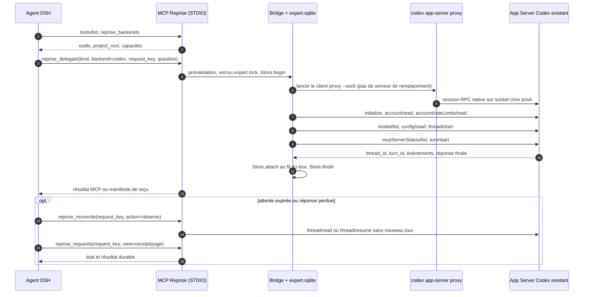

# De DeepSeek Harness à Codex par Reprise — route opérateur

> **Référence humaine pour les futures demandes d'évolution.** Cette page décrit la route **DSH → Reprise → Codex** telle qu'implémentée dans `dev@a55d593b357b0d0a40ec3539acc17c049feb31a7` (17 novembre 2026). Elle explique le fonctionnement du code, **sans prétendre que la release et le profil actuellement chargés sur le Mac sont identiques**. Après une mise à jour, confirmer les capacités réelles avec `reprise_backends` et les reçus de bout en bout.

## Définir précisément « déléguer à Codex »

| Chemin | Point d'entrée | Propriétaire de la tâche et des preuves |
| --- | --- | --- |
| **Via Reprise** (objet de cette page) | DSH appelle le serveur MCP `reprise_experts` : `reprise_delegate(backend="codex", ...)` | Reprise : requête, garde de rejeu, reçu durable et réconciliation ; Codex : thread et tour natifs |
| **Directement dans DSH** | DSH choisit son fournisseur `openai-codex` ou le modèle d'un sous-agent Harness | DSH : conversation et exécution ; aucun reçu Reprise créé par cette seule sélection |
| **Sous-agent DSH qui appelle Reprise** | Un sous-agent Harness appelle explicitement `reprise_delegate` | DSH conserve sa sous-session ; Reprise conserve la délégation Codex appelée par celle-ci |

Choisir un modèle Codex dans la configuration de DSH **ne signifie pas** déléguer par Reprise. Les identifiants de modèle du fournisseur direct de DSH ne sont pas nécessairement les identifiants admissibles pour la route Codex de Reprise. Ne jamais déduire un transport, une facturation, un droit d'écriture ou une disponibilité du seul nom « Codex ».

## Parcours concret



Le schéma distingue le processus **client** `codex app-server proxy --sock ...` de l'App Server **propriétaire** existant. `codex_rpc.Client` utilise un transport WebSocket RFC 6455 sur le proxy local. L'absence du socket privé, son propriétaire incorrect ou l'indisponibilité du serveur entraînent un refus : Reprise ne crée pas de nouveau serveur pour contourner la propriété des sessions. Ce canal ne nécessite pas de piloter une interface graphique.

### 1. Exposer le bon outil dans le bon projet

Le parcours de gestion de Reprise prépare l'intégration du profil DSH via `reprise harness-integration-inspect`, `harness-integration-plan --action install`, `harness-integration-apply` et `harness-integration-verify`. Le plan doit viser explicitement **le projet** et **le profil** autorisés. Le pont installé utilise `@deepseek-ai/dsh-mcp-client`, `transport: stdio`, `serverName: reprise_experts`, le Python de la **release d'intégration versionnée**, `expert_mcp.py` et les paramètres `--project-root`, `--state`, `--tools`. L'installateur ne retouche pas les identifiants Codex ni ne démarre DSH.

- La liste des outils est `OBSERVE` (`reprise_backends`, `reprise_requests`, `reprise_quotas`, `approval_list`, `wait_result`) plus `DELEGATE` (`reprise_delegate`, `reprise_followup`, `reprise_reconcile`), toujours exposés depuis #252. `approval_respond` n'est pas exposé. Une installation antérieure peut encore présenter une ancienne allowlist ; **c'est `tools/list` qui décide**.
- Après l'application, **recharger le profil ou une nouvelle session DSH**. Le `verify` lance une sonde directe `initialize` / `tools/list`, ce qui ne prouve pas que DSH lui-même a chargé le pont.
- Dans DSH, découvrir `mcp__reprise_experts__reprise_backends` ; confirmer le `project_root`, `configured`, `modes`, `models` et les outils réellement visibles. Le projet de la session DSH et le `project_root` fixé dans la configuration MCP peuvent être différents. Nuance : un profil géré déployé avant le renommage n'est pas régénéré automatiquement — le préfixe legacy `mcp__reprise_codex__*` peut encore apparaître jusqu'à la prochaine installation/régénération ; les deux conventions désignent le même serveur.

### 2. Admettre une demande identifiée

DSH appelle `mcp__reprise_experts__reprise_delegate`, avec `backend: "codex"`, `kind: "expertise" | "review" | "batch"`, une `question` (12 000 caractères maximum, y compris le préfixe de contrat ajouté), éventuellement `level`, `mode`, un modèle explicitement annoncé, et au plus 30 chemins **relatifs au projet lié**. DSH **persiste lui-même** une `request_key` unique avant l'appel ; les enfants utilisent `parent_request_key` si leur parent est connu.

Le pont vérifie la validité des paramètres, les permissions, les fichiers d'entrée et l'admissibilité de la route. Il prend un verrou de sérialisation `expert.lock`, puis `Store.begin` dans `expert.sqlite`. Un rejeu de la même clé avec les mêmes entrées ne crée pas un nouveau tour. Une même clé avec un payload différent est refusée ; une demande incertaine ne doit pas être « débloquée » par une nouvelle clé. Le journal de routage est distinct du reçu métier.

**Sélection par défaut dans cette baseline**, sous réserve du catalogue réellement annoncé par Codex : `expertise` ou `review` standard → `gpt-6.1-sol` / medium ; `batch` standard → `gpt-6-luna` / medium ; `deep` → `gpt-6-astra` / high. L'absence du modèle demandé n'autorise pas une substitution silencieuse.

### 3. Ouvrir une session Codex native

Après connexion au serveur propriétaire existant, Reprise vérifie `account/read` : **connexion au compte ChatGPT requise**, pas de bascule implicite vers une clé API facturée séparément. `account/rateLimits/read` doit autoriser l'inférence avec une réserve fournisseur de 5 % ; quota absent ou inconnu = refus prudent.

Reprise crée un `thread/start` non éphémère, ancré dans le `cwd` canonique du projet, ou reprend le `thread_id` d'une session déjà détenue et disponible. Il vérifie le fournisseur, le dossier, l'état `idle`, le routage modèle/effort et l'isolement MCP effectif ; la liste des serveurs natifs hérités doit les indiquer désactivés. `turn/start` porte la sandbox et la politique d'approbation. `thread_id` et `turn_id` sont conservés durablement **avant l'attente du résultat**.

Le `project_root` et les chemins ciblés empêchent d'envoyer cette demande vers un autre projet par erreur ; ils ne constituent pas une preuve de confinement absolu de toutes les lectures du processus.

### 4. Définir l'autorisation (pas seulement le type de travail)

`kind` décrit le **livrable** ; `mode` décrit les **permissions** :

| Mode | Comportement effectif |
| --- | --- |
| `mode: "expertise"` (défaut) | Sandbox native `readOnly`, réseau désactivé, instructions interdisant les modifications ; avis, revue ou patch complet à faire appliquer/vérifier par le demandeur |
| `mode: "implementation"` | Permis par défaut depuis #252 dans le projet du pont. Sandbox native `workspaceWrite`, réseau désactivé, modifications et tests locaux permis. Cela **n'autorise pas** automatiquement push, merge, déploiement ou changement de service |

L'écriture dans le projet est permise par défaut (#252) ; elle reste bornée au `project_root` du pont, réseau coupé. Le mode est attaché au thread et hérité lors de `reprise_followup` ; on ne transforme pas une revue en session inscriptible en cours de route. Les approbations Codex restent humaines ; Reprise ne répond pas automatiquement à leur place.

### 5. Suivre et terminer le tour sans confondre les preuves

Le pont capture les notifications du **tour exact**, les éventuels messages finaux et son état terminal, et enregistre un résultat durable.

| État du reçu | Ce qu'il signifie | Comportement du demandeur |
| --- | --- | --- |
| `finished` | Tour natif terminé avec réponse finale capturée, non tronquée et preuve `native:completed` | Lire et vérifier le livrable ; cela **ne prouve pas** l'atteinte de l'objectif métier |
| `running` | L'attente MCP a expiré mais le tour Codex peut toujours travailler | Observer avec `reprise_reconcile(action="observe")`, **pas de nouveau dispatch** |
| `awaiting_approval` | Une action native requiert une intervention humaine | Traiter l'approbation par la voie explicitement autorisée ; aucune approbation automatique |
| `needs_review` ou `owner_unavailable` | Le résultat final ou la propriété du tour ne peuvent pas être établis | Conserver l'incertitude, rapprocher l'état natif et le reçu |
| `interrupted` | Arrêt natif confirmé | Résultat non achevé ; pas de retry implicite |
| `blocked_auth`, `quota_blocked`, `blocked_owner`, `blocked_session`, `blocked_permission` | Une garde refuse la route ou le tour | Corriger la cause ; ne pas contourner la garde |

Quatre budgets sont indépendants : `wait_seconds` borne seulement l'attente de DSH (défaut 30 s), `inactivity_seconds` produit un diagnostic, `execution_seconds` décrit une limite d'exécution **sans arrêt** tant que `stop_on_deadline` n'est pas explicitement vrai ; le quota fournisseur et les éventuels budgets utilisateur sont des contrôles distincts. Un arrêt explicite passe par `reprise_reconcile(action="stop", reason="user_stop" | "execution_deadline" | "budget")`.

Un résultat réussi de `turn/start` n'est pas une preuve de fin. Une réponse visible de Codex n'est pas une preuve d'écriture correcte, de tests passés, de publication ou de déploiement.

### 6. Reprendre le résultat ou poursuivre le thread

`return_mode: "full"` (défaut) retourne la réponse bornée. `return_mode: "receipt"` retourne un manifeste compact de résultat **déjà persisté**, consultable par `reprise_requests(request_key=..., view="receipt")`. Si disponible, lire les pages `view="page"` avec `offset`, `max_chars <= 6000` et `result_sha256` stable ; vérifier longueur et SHA-256 avant de reconstituer le JSON. Acquitter explicitement le reçu enregistré avec `acknowledge=true`. La consultation de pages ne vaut pas acquittement.

Pour une **nouvelle demande relative au même travail**, `reprise_followup` accepte `backend: "codex"`, un nouveau `request_key`, le `thread_id` détenu par le pont, et une question limitée aux faits nouveaux. Le suivi est impossible si l'identité et l'historique natif ne sont pas vérifiables. Il conserve le mode de permissions de la session originelle ; un modèle explicitement demandé doit rester disponible.

## Exemple indicatif d'appel DSH

**Prérequis :** `reprise_backends` a confirmé que `project_root` pointe sur ce dépôt et que `reprise_delegate` est exposé.

```json
{
  "backend": "codex",
  "kind": "review",
  "level": "standard",
  "mode": "expertise",
  "request_key": "dsh-review-codex-20261117-a1",
  "question": "À partir de la baseline indiquée, audite les pannes du pont Codex RPC. Ne modifie rien. Cite fichiers, lignes, sévérité, preuves et tests de reproduction.",
  "paths": ["reprise/codex_rpc.py", "reprise/codex_expert.py"],
  "wait_seconds": 30,
  "return_mode": "receipt"
}
```

Ce JSON est le **payload** de `mcp__reprise_experts__reprise_delegate`, pas une commande shell ni une nouvelle route de fournisseur DSH. Une clé d'exemple doit être remplacée par une clé unique persistée côté demandeur. Un simple `reprise_delegate` en `expertise` ne réserve **pas** une issue GitHub et n'octroie pas les permissions de commit.

## Vocabulaire commun pour les demandes d'évolution

Préciser dans chaque issue ou décision :

1. **Point d'entrée** : appel MCP Reprise, fournisseur direct DSH ou sous-agent DSH.
2. **Route native** : Codex App Server partagé, autre adaptateur ou chemin à créer ; propriétaire du thread/du socket et contraintes de cycle de vie.
3. **Contrat d'admission** : `request_key`, projet lié, permissions, garde contre les doublons et état de facturation.
4. **Contrat de résultat** : qui peut affirmer `finished`, données dans le reçu, observation/réconciliation, validation du livrable.
5. **Frontière de déploiement** : code dans `dev`, configuration installée, outil découvert par DSH, appel réel prouvé ; ce sont **quatre états distincts**.
6. **Preuves attendues** : SHA du code et de la release chargée, outil découvert, `request_key`, `thread_id`, `turn_id`, état terminal et tests réellement exécutés.

Une évolution de **modèle DSH** ne doit pas être présentée comme une évolution du **transport Reprise** ; une évolution du **pont Reprise** ne doit pas être présentée comme le déploiement d'une nouvelle release. Distinguer toujours permission de modifier, permission de publier et preuve de résultat métier.

## Sources de vérité dans le dépôt

- [Installation Harness et allowlist](HARNESS-INTEGRATION.md) : `reprise/harness_integration.py`.
- [Pont MCP, prévalidation, identités et reçus](../../../reprise/expert_mcp.py) : `Bridge.call`, `Bridge._call`, `Bridge._reconcile`.
- [Manifeste experts déclaratif](../../../reprise/experts-manifest.json) (#258 lot 2, #259) : capacité/`session`/`enabled` par backend, refus deterministes et diagnostic `reprise_experts_list` — « le manifeste décrit, la disponibilité se mesure » ; voir la section dédiée de [CODEX-INTEGRATION.md](../codex/CODEX-INTEGRATION.md).
- [Transport RPC Codex](../../../reprise/codex_rpc.py) et [sélection/validation du socket](../../../reprise/engines.py).
- [Tours natifs Codex, compte, quota et sandbox](../../../reprise/codex_expert.py).
- [Persistance des délégations](../../contracts/DELEGATION-PERSISTENCE.md) : `reprise/delegation_store.py` et `reprise/delegation_reconcile.py`.
- [Autorisation d'implémentation](../../contracts/CODEX-EXECUTION-CONTRACT.md).
- [Détails et expérimentations historiques Codex](../codex/CODEX-INTEGRATION.md).

**Frontière de vérification :** analyse du code versionné, pas inspection d'une installation DSH active ; ni test de bout en bout effectué pour cette rédaction, ni changement d'état local.
